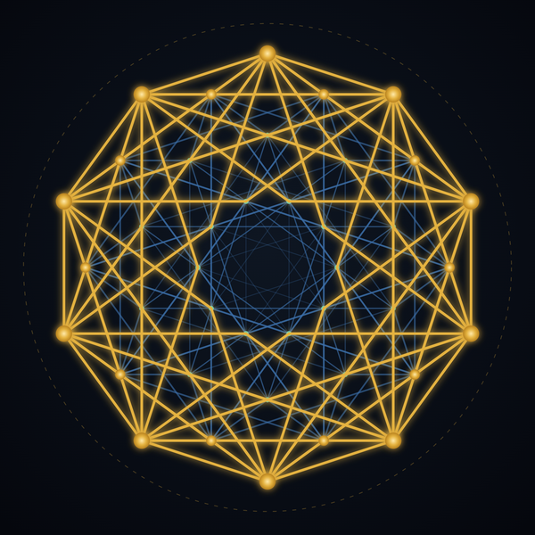

# Roberto E. Adrian

**Independent researcher and inventor · KIT alumnus**

[Website](https://www.adrian-structure.com) · [ORCID](https://orcid.org/0009-0007-4347-2795) · [Zenodo](https://zenodo.org/search?q=%22Roberto%20Adrian%22) · [Contact](mailto:roberto.adrian@adrian-structure.com)

---

## Adrian-Structure

Prime numbers induce a simplicial complex. Measuring that complex topologically yields
three constants, and reconstructing from them yields a five-dimensional object — the
rectified 5-orthoplex, whose 40 vertices are the minimal vectors of the D₅ lattice.

The work does not stop at the mathematics. The same structure is carried into
**software** (algorithms, reconstruction tools) and into **hardware** (FPGA operators
derived from *Principia Mathematica*, simplified via the Sheffer stroke and measured on
the board).

## Four lines of work

| | |
|---|---|
| **Structure** | Topological observables of the prime-induced complex; the shape in 2D → 5D |
| **Hardware** | Operators on FPGA; arithmetic accelerators; patent work |
| **Learning** | Humanoid robot learning |
| **Genetics** | Structure applied to biological networks |

## How results are verified

Every claim that counts is written as a **Lean 4** theorem and must compile without
`sorry`, checked with `#print axioms`. What is not in Lean is not yet a result.

## Publications

Papers and Lean proofs are published openly on Zenodo, in German and English.
Two communities collect the work:

- *Adrian-Structure versus Millennium Problems*
- *Open Lean Proof Library – Millennium Problems*

---

Mathematics · Software · Hardware

